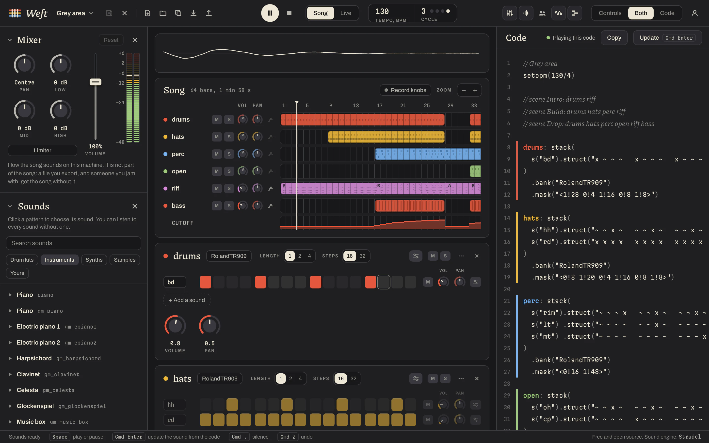
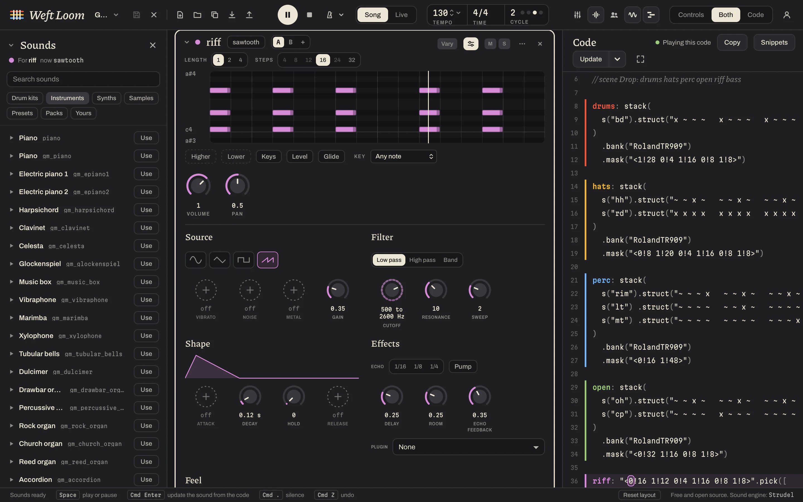
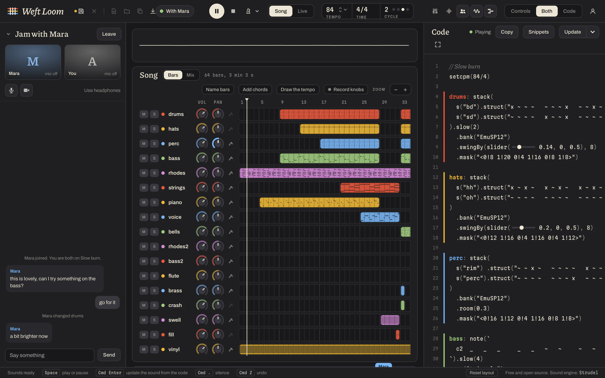

# Weft Loom

A free, open-source desktop app for making music with [Strudel](https://strudel.cc). Every pattern of a song is shown twice: as controls and as Strudel code. The code is the song; the controls read it and rewrite it, so you can make a whole song without writing any, and read or change the code whenever you want to.

- Step grids for drums, piano rolls for notes, and a knob for every number in the code.
- A browser for trying and choosing sounds, and for recording or bringing in your own.
- A Song panel where you choose the bars each pattern plays in, draw a knob over the song bar by bar, and give a pattern versions for the verse and the chorus.
- Scenes for playing a song live, and notes played in from the computer's keyboard.
- A mixer with volume, pan, tone, a limiter and level meters.
- Export as a sound file, as a file for each pattern, as code, or as one `.weft` file that holds the song and its sounds.
- Jams: two people on one song at once, each on their own machine, with chat, voice and a camera.
- Publishing songs to the site, where others can listen and open a copy.

How each of these works is in the [docs](https://weftloom.dev/docs), with pictures.

Weft Loom is free and stays free. If it helps you make music, you can [buy me a coffee](https://weftloom.dev/coffee).

## Run it

    npm install
    npm run dev          # in a browser, http://localhost:5180
    npm run tauri:dev    # in a desktop window (needs Rust)

The dev server also starts the relay that jams go through and the site that songs are published to, both on this machine.

## Test it

    npm test             # unit tests
    npm run test:e2e     # browser tests, in WebKit (what the macOS window uses)
    npm run typecheck

## The site and the relay

    npm run build:server

puts the site and the relay into `dist-server` as one file that runs with Node alone. `server/start.ts` says what it reads from the environment.

## Licence

AGPL-3.0-or-later, the same as Strudel, which this app is built on.
